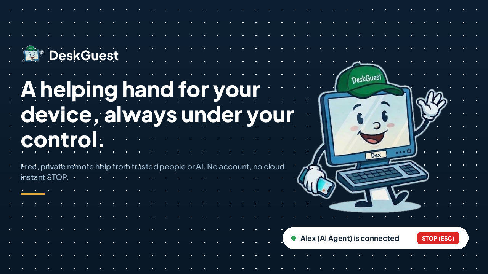

  

  
  
  
  

  <strong>DeskGuest lets a trusted person — or your own AI agent — help you on your computer or phone, while you see everything they do and can stop them instantly.</strong> 
  No account. No DeskGuest cloud. Devices know each other by cryptographic keys, and there is no way to connect quietly.

  <strong>Status: in development — downloads aren't open yet.</strong> When they open, they'll live on <a href="https://deskguest.pages.dev/download">the download page</a> and in this repo's releases, always with a File Check Code (SHA-256) to verify — and nowhere else. DeskGuest is not in any app store.

  

<!-- REAL-CAPTURE SLOT: when a genuine screenshot of the shipping app exists
     in .github/assets (a live session with the presence box up), place it
     here with honest alt text. Artwork and mock-ups never go in this slot. -->

## Why it's different

- **Help can only happen while you can see it.** Whoever is connected is named on your screen the whole time, and STOP — on screen, or the Esc key — ends the session instantly. No setting, no policy, and no helper can switch that off.
- **No account, no cloud, nothing phoning home.** Your identity is a key made on your device. We have no copy of it, run no cloud of our own, and collect no telemetry.
- **Your AI, on your leash.** Pair the AI agent you already use. It connects under its own name, starts at look-only, and stops to ask before anything sensitive.
- **Everything is written down, on your device.** Every session leaves a plain-language record you own: who was here, what they did.

## Two installs per platform — that's the whole choice

<table>
  <tr><th></th><th>DeskGuest: Full Platform</th><th>DeskGuest: Quick Fix</th></tr>
  <tr>
    <td><strong>Windows 11</strong></td>
    <td>The complete product in one install — every role, chosen at install: help others, receive help, or be reachable unattended.</td>
    <td>Opens in your browser from an invite link — voice, chat, screen sharing. One more tap brings in a one-time helper program for full control; when the session ends, it removes itself and the link dies. Never reachable unattended.</td>
  </tr>
  <tr>
    <td><strong>Android 11+</strong></td>
    <td>The complete product for your phone, with the same presence, approvals and STOP.</td>
    <td>The mobile door into a one-time session or a room, from a single invite link.</td>
  </tr>
</table>

## Where it's been tried

We only claim what we've tried:

| Platform | Support statement |
|---|---|
| Windows | Works on **Windows 11** — the system we've tried it on. Windows 10 is not supported. |
| Android | Works on the **Samsung Galaxy S25 Ultra** — the phone we've tried it on. Installing needs **Android 11 or newer**. Other phones haven't been tried yet. |
| Mac / Linux | Not available. There is no Mac or Linux version. |

## AI agents

DeskGuest works with any AI agent that uses MCP, the open connection standard. **Fully supported** means we've paired it with DeskGuest and put it through its paces end to end ourselves — so far that's **ChatGPT** (via the Codex app) and **DeepSeek** (via dsh). The others — Claude Code, Gemini, Goose, Muse by Meta — are documented by their makers but **not yet tried**. One worth knowing: Muse by Meta runs in Meta's cloud, so it can only reach a device over the internet, never one that's only on your home network. [The AI page](https://deskguest.pages.dev/ai) keeps the exact table, and it changes as we try more.

## Explore

| | |
|---|---|
| **[Features](https://deskguest.pages.dev/features)** | The whole product, family by family — presence, Quick Fix, rooms, groups, recovery |
| **[About](https://deskguest.pages.dev/about)** | Why DeskGuest exists — help in the open instead of a black box — and an honest comparison with TeamViewer, AnyDesk, RustDesk and Zoom & Teams |
| **[How it works](https://deskguest.pages.dev/how-it-works)** | Three steps, and how pairing puts you in charge |
| **[AI agents](https://deskguest.pages.dev/ai)** | Bring your own agent: the leash, the approvals, and which AIs are fully supported vs not yet tried |
| **[Rooms & collaboration](https://deskguest.pages.dev/rooms)** | Standing meeting rooms — members, links, and the room's memory |
| **[Quick Fix](https://deskguest.pages.dev/quick-fix)** | One-time help for anyone from a single invite link — no install, no pairing first |
| **[Download](https://deskguest.pages.dev/download)** | Where downloads will live when they open — and the support statement, exactly as far as it's been tried |
| **[Help & Support](https://deskguest.pages.dev/support)** | Guides, the uh-oh report, and how to get help |
| **[Trust & Security](https://deskguest.pages.dev/trust)** | The consent floor: what no setting and no policy can switch off |
| **[Security](https://deskguest.pages.dev/security)** | The threat model, in plain words — including what DeskGuest does not claim |
| **[Privacy](https://deskguest.pages.dev/privacy)** | No account, no cloud, no telemetry — and what that means in practice |
| **[Terms of Service](https://deskguest.pages.dev/terms)** | The full terms (v1.0) — the same text the installer shows on its first page, before anything is installed, and a pairing asks an agent to acknowledge |
| **[Verify a download](https://deskguest.pages.dev/verify)** | Check a file's File Check Code (SHA-256) before you run it |
| **[Is this a scam?](https://deskguest.pages.dev/scam)** | The three signs of a genuine DeskGuest session, and the red flags |
| **[For Workplaces](https://deskguest.pages.dev/workplaces)** | Groups, signed policy and local audit — without a fleet roster on endpoints |
| **[For IT](https://deskguest.pages.dev/it)** | The evaluation pack: the support matrix stated exactly, sizing, policy — and what happens to your data when an AI agent helps |

## Get help

- **Questions and ideas:** [GitHub Discussions](https://github.com/DeskGuest-App/DeskGuest/discussions)
- **Something broken:** [open an issue](https://github.com/DeskGuest-App/DeskGuest/issues) — say what you tapped, what you expected, and what happened instead. If DeskGuest showed an uh-oh, its **Report** button builds the report for you, with passwords and private keys left out.
- **Security problem:** report it privately — see [SECURITY.md](SECURITY.md). Please don't open a public issue for a vulnerability.

## Contributing

See [CONTRIBUTING.md](CONTRIBUTING.md). DeskGuest is a community project, launched by a named individual; it is not a company product and carries no support contract or SLA.

## License

Apache-2.0 — see [LICENSE](LICENSE).
