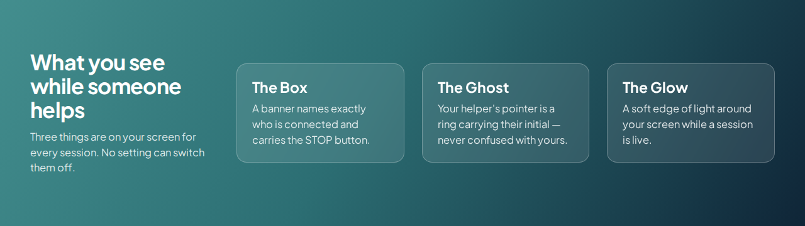

  

  
  
  
  

  <strong>DeskGuest lets a trusted person — or your own AI agent — help you on your computer or phone, while you see everything they do and can stop them instantly.</strong> 
  No account. No DeskGuest cloud. Devices know each other by cryptographic keys, and there is no way to connect quietly.

  

## Two installs per platform — that's the whole choice

<table>
  <tr><th></th><th>DeskGuest: Full Platform</th><th>DeskGuest: Quick Fix</th></tr>
  <tr>
    <td><strong>Windows 11</strong></td>
    <td>The complete product in one install — every role, chosen at install: help others, receive help, or be reachable unattended.</td>
    <td>A tiny one-time helper for a single attended session. No install trail, no account, never unattended-capable — it removes itself when the session ends.</td>
  </tr>
  <tr>
    <td><strong>Android 11+</strong></td>
    <td>The complete product for your phone, with the same presence, approvals and STOP.</td>
    <td>The mobile door into a one-time session or a room, from a single invite link.</td>
  </tr>
</table>

<strong>Downloads are not open yet.</strong> When they are, this page and <a href="https://deskguest.pages.dev/download">the download page</a> will carry the installers and their File Check Codes (SHA-256) — and nothing else will. DeskGuest is not in any app store.

## Explore

| | |
|---|---|
| **[Features](https://deskguest.pages.dev/features)** | The whole product, family by family — presence, Quick Fix, rooms, groups, recovery |
| **[How it works](https://deskguest.pages.dev/how-it-works)** | Three steps, and how pairing puts you in charge |
| **[Trust & Security](https://deskguest.pages.dev/trust)** | The consent floor: what no setting and no policy can switch off |
| **[Security](https://deskguest.pages.dev/security)** | The threat model, in plain words — including what DeskGuest does not claim |
| **[Privacy](https://deskguest.pages.dev/privacy)** | No account, no cloud, no telemetry — and what that means in practice |
| **[Verify a download](https://deskguest.pages.dev/verify)** | Check a file's File Check Code (SHA-256) before you run it |
| **[Is this a scam?](https://deskguest.pages.dev/scam)** | The three signs of a genuine DeskGuest session, and the red flags |
| **[For Workplaces](https://deskguest.pages.dev/workplaces)** | Groups, signed policy and local audit — without a fleet roster on endpoints |
| **[For IT](https://deskguest.pages.dev/it)** | The support matrix, stated exactly: what is proven, and on what hardware |
| **[Help & Support](https://deskguest.pages.dev/support)** | Guides, the uh-oh report, and how to get help |

## Get help

- **Questions and ideas:** [GitHub Discussions](https://github.com/DeskGuest-App/DeskGuest/discussions)
- **Something broken:** [open an issue](https://github.com/DeskGuest-App/DeskGuest/issues) — say what you tapped, what you expected, and what happened instead. If DeskGuest showed an uh-oh, its **Report** button builds the report for you, with passwords and private keys left out.
- **Security problem:** report it privately — see [SECURITY.md](SECURITY.md). Please don't open a public issue for a vulnerability.

## Contributing

See [CONTRIBUTING.md](CONTRIBUTING.md). DeskGuest is a community project, launched by a named individual; it is not a company product and carries no support contract or SLA.

## License

Apache-2.0 — see [LICENSE](LICENSE).
