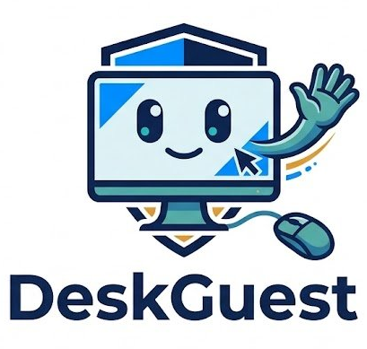

  

# DeskGuest

  
  
  
  

**A helping hand for your computer, always under your control.**

DeskGuest is free software that lets a trusted person — or your own AI agent —
connect to your computer or phone and help you, while you see everything they
do and can stop them instantly.

- **No account.** DeskGuest has no sign-up and no DeskGuest cloud. Devices
  know each other by cryptographic keys, not by accounts.
- **Nothing hidden.** While anyone is connected, your screen shows who is
  here, what they are doing, and a STOP button that always works. There is
  no way to connect quietly.
- **You are always the boss.** You choose who may connect, what they may do,
  and you can remove them at any time.
- **Free, for everyone.** No tiers, no user limit, no device limit.

## Status

DeskGuest is **in development**. Downloads are **coming soon** — there is no
release yet, and any site or store listing offering a DeskGuest download today
is not us. When downloads open, they will be published on this repository's
Releases page, each with a File Check Code (SHA-256) so you can verify your
download is the file that was published.

Support is being proven first on Windows 11 and the Samsung Galaxy S25 Ultra.
Other platforms are not claimed until they are proven on real hardware.

## What's here

- `windows/` — the Windows app and core service (.NET).
- `android/` — the Android app.
- `website/` — the project website (plain static HTML/CSS/JS, no build step,
  no tracking).

## Get help

- Ask a question or start a conversation in
  [Discussions](https://github.com/DeskGuest-App/DeskGuest/discussions).
- Report a bug or request a feature in
  [Issues](https://github.com/DeskGuest-App/DeskGuest/issues) — the templates
  there walk you through it.
- Found a security problem? Please do **not** open a public issue. See
  [SECURITY.md](SECURITY.md) for the private reporting route.

Inside the app, the Report button on any error screen prepares a diagnostics
package for you: it is scanned for passwords, keys, and tokens before anything
is attached, and nothing is ever sent until you press Send.

## Contributing

See [CONTRIBUTING.md](CONTRIBUTING.md).

## License

DeskGuest is open source under the [Apache License 2.0](LICENSE).
